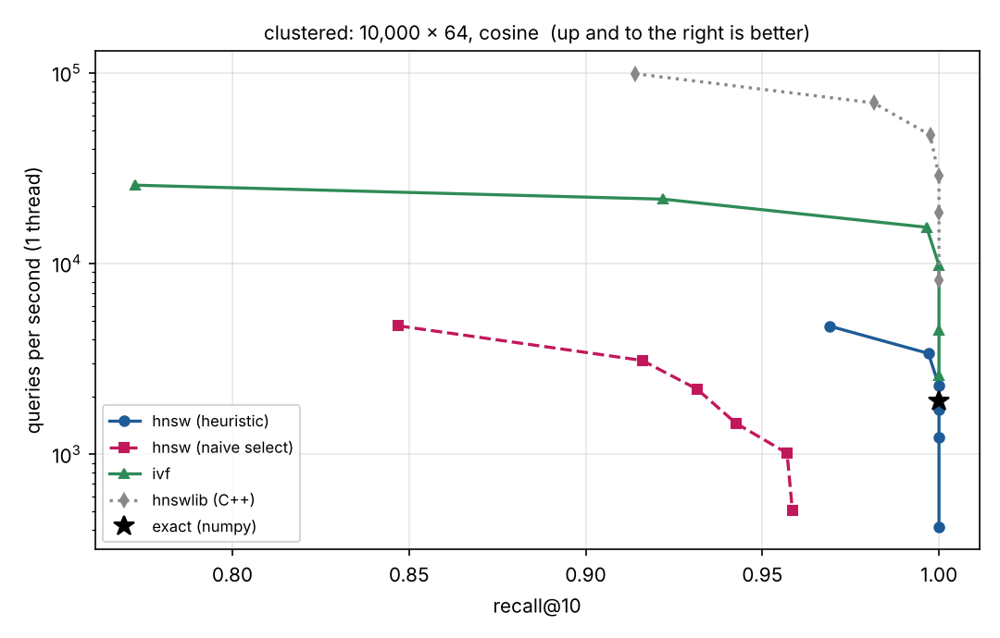

# pyvecdb

A small vector database and grounded-RAG workbench in Python. It is built to be **correct, measurable and
inspectable**: every index is tested against exact search, every claim below has a script that reproduces it,
and the web UI shows *where in embedding space* each answer came from.



*Recall@10 vs queries/second on 10,000 clustered 64-d vectors (cosine, one CPU core). Up and to the right is
better. Reproduce with `python benchmarks/run_ann.py`.*

## What's inside

| Piece | What it does |
|---|---|
| `pyvecdb.index` | `BruteForce` (exact), `HNSW`, `IVFFlat`. NumPy only, tombstone deletes, no pickle snapshots. |
| `pyvecdb.Collection` | Ids, JSON payloads, upsert, metadata filtering, `compact()`, atomic single-file snapshots, thread-safe. |
| `pyvecdb.embed` | Offline `HashingEmbedder` (tests/demos), `OllamaEmbedder`, `SentenceTransformerEmbedder`. |
| `pyvecdb.rag` | Sentence-aware chunker, BM25, hybrid retrieval with reciprocal-rank fusion, MMR, grounded prompt with citation checking, abstention. |
| `pyvecdb serve` | FastAPI JSON API + a web UI with a live 2-D map of your chunks. |
| `benchmarks/` | ANN recall-vs-QPS harness (with an `hnswlib` reference) and a retrieval/answering evaluation. |

## Quick start

```bash
pip install -e ".[dev]"            # add ,bench for plots and the hnswlib reference
pyvecdb serve --demo               # http://127.0.0.1:8000  (loads 12 sample documents)
```

Use real models instead of the offline embedder (needs a running [Ollama](https://ollama.com)):

```bash
ollama pull nomic-embed-text && ollama pull llama3.2
pyvecdb serve --data ./pyvecdb.npz --embedder ollama:nomic-embed-text --llm ollama:llama3.2
```

As a library:

```python
import numpy as np
from pyvecdb import Collection

col = Collection(dim=128, metric="cosine", index="hnsw", M=16, ef_construction=200)
col.add(["a", "b"], np.random.rand(2, 128), [{"lang": "en"}, {"lang": "fr"}])
hits = col.search(np.random.rand(128), k=5, ef=64, where={"lang": "en"})   # [Hit(id, distance, payload)]
col.save("index.npz"); col = Collection.load("index.npz")
```

```python
from pyvecdb.embed import get_embedder
from pyvecdb.rag import RAGPipeline

rag = RAGPipeline(get_embedder("hashing"), path="rag.npz")
rag.ingest("HNSW notes", open("hnsw.txt").read())
print(rag.ask("How does HNSW search start?")["answer"])      # cited, or "I don't know ..."
```

## Results (measured, with caveats)

All numbers: 1 CPU core, 200 queries, k=10, M=16, ef_construction=100, from `benchmarks/results/*.json`.

**Clustered data, 10,000 x 64, cosine**

| Method | Setting | recall@10 | queries/s | build |
|---|---|---|---|---|
| exact (NumPy) | | 1.000 | 1,888 | |
| pyvecdb HNSW, diversity heuristic | ef=20 | 0.997 | 3,376 | 23.7 s |
| pyvecdb HNSW, diversity heuristic | ef=40 | 1.000 | 2,281 | 23.7 s |
| pyvecdb HNSW, **naive nearest-M selection** | ef=40 | 0.932 | 2,196 | 8.5 s |
| pyvecdb HNSW, naive nearest-M selection | ef=320 | 0.958 | 508 | 8.5 s |
| pyvecdb IVF (nlist=100) | nprobe=4 | 0.996 | 15,497 | 0.1 s |
| hnswlib (C++) | ef=40 | 0.998 | 47,207 | 0.5 s |

What this says, and what it doesn't:

* **The neighbour-selection heuristic is the difference between a working and a broken HNSW.** With the paper's
  heuristic recall reaches 1.000 at ef=40. With naive nearest-M selection it never gets past 0.958, even at ef=320
  (the graph fragments into clusters). Run `run_ann.py` to see the ablation; `tests/test_indexes.py` enforces it.
* **Recall is on par with (here slightly above) `hnswlib` at the same ef**, but this implementation is pure Python: about 20x slower than
  `hnswlib` at equal recall and about 50x slower to build.
* **At this size HNSW barely beats exact NumPy search (about 1.2x).** IVF is the fastest NumPy-only option here. I did
  not test beyond 10,000 vectors (the sandbox had one core and 3 GB), so where HNSW overtakes IVF is unmeasured.
* **Real data (scikit-learn digits, 1,597 x 64, L2):** exact search (9,445 q/s) is faster than every index, and all
  graph variants plateau at 0.997 recall (`hnswlib` reaches 0.998; the remaining misses are probably distance ties, but I
  did not verify that). Below a few thousand vectors, brute force is the right answer.
* Synthetic Gaussian-mixture data is not a substitute for SIFT/GloVe-scale benchmarks. Use
  `--dataset npy --base base.npy --queries-file q.npy` to run your own vectors.

**RAG evaluation (bundled corpus: 12 documents, 24 answerable + 3 unanswerable questions, offline hashing embedder,
extractive answerer):** hit@3 = 1.00 for dense, BM25 and hybrid at both chunk sizes tried; hybrid and BM25 reach MRR 1.00 (dense 0.97 to 0.98);
the pipeline answers 22 of 24 answerable questions and abstains on all 3 unanswerable ones. That corpus is tiny and the
hashing embedder is lexical, so this is a **regression test, not evidence of real-world quality**. Run
`python benchmarks/eval_rag.py --embedder ollama:nomic-embed-text --llm ollama:llama3.2 --corpus yours.json` on your data.

## Design notes

* **Cosine = unit vectors + dot product.** Vectors are normalised once on insert, so cosine distance is `1 - dot` and every
  index runs on matrix products. (The KD-tree in the C++ version used a pruning bound that is invalid for cosine and returned
  wrong neighbours; it is gone.)
* **HNSW** follows Malkov & Yashunin: exponential level assignment, `ef` beam search per layer, Algorithm 4 neighbour
  selection with `keepPrunedConnections`. `heuristic=False` is kept only for the ablation.
* **Deletes are tombstones.** Removing a node can disconnect a graph; dead nodes keep routing but are never returned, search
  widens its beam when tombstones crowd results, and `Collection.compact()` rebuilds without them.
* **Snapshots are one `.npz` file**, written to a temp file, fsynced and renamed: a crash can never leave a half-written
  database. No pickle, so loading an untrusted snapshot cannot execute code.
* **Hybrid search uses reciprocal-rank fusion**, which needs no calibration between BM25 and cosine scores.
* **Answers are grounded:** the prompt demands numbered citations and an exact abstention sentence, treats excerpts as
  untrusted data, and every `[n]` in the answer is validated against the excerpts actually supplied. A built-in extractive
  answerer works with no LLM and cannot hallucinate (it also cannot synthesise across sources).
* **Metadata filtering is post-filtering**: the search is widened until `k` matches are found. Very selective filters on
  large collections will be slow.

## Security defaults

Binds to `127.0.0.1`; optional `--api-key` (`X-API-Key`, constant-time compare); CORS is off unless you pass
`--cors-origin` (never `*`); strict CSP, `nosniff`, `frame-ancestors 'none'`; the UI renders all server text with
`textContent`; document text is capped at 1,000,000 characters. The server warns if you bind beyond localhost without a key.
Swagger is at `/api/swagger`.

## API

| Method | Path | |
|---|---|---|
| GET | `/api/health` | open; reports whether auth is on |
| GET / POST | `/api/docs` | list / add `{title, text, source?}` |
| DELETE | `/api/docs/{doc_id}` | remove a document |
| POST | `/api/search` | `{query, k, mode: dense\|bm25\|hybrid, mmr?}` |
| POST | `/api/ask` | same body; returns answer, citations, contexts, timings, `abstained` |
| GET | `/api/map` | 2-D PCA projection of every chunk |
| POST | `/api/demo` | load the bundled sample documents |

## Development

```bash
pytest                      # 56 tests: index recall/deletes/persistence, chunking, RAG, Ollama client, API
ruff check .
python benchmarks/run_ann.py --dataset clustered --n 10000 --dim 64
python benchmarks/eval_rag.py
```

## Known limits

* Pure-Python HNSW: fine for thousands to low hundreds of thousands of vectors, not millions.
* One process, one writer (a lock serialises access); every change rewrites the snapshot, which is fine for small
  collections and wasteful for big ones.
* `HashingEmbedder` matches words and word fragments, not meaning. Use a real model for semantic search.
* The Ollama and sentence-transformers backends are covered by tests against a fake Ollama server and by code review, but were
  **not exercised against a live Ollama or a downloaded model** during development.
* The Docker image and the GitHub Actions workflow were written but not run.
* The UI's logic and safety (rendering, citations, hostile titles) are tested in a simulated DOM; the canvas drawing was not
  checked in a real browser.

## Roadmap

Product quantization + exact rerank, a cross-encoder reranker adapter, background/incremental snapshots, true filtered
HNSW traversal, and a numba or C-extension distance kernel.

MIT licensed.
